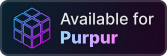
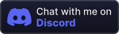

<br>
<p align="center">
  <a href="https://papermc.io/">
    
  </a>
  <a href="https://purpurmc.org/">
    
  </a>
  <a href="https://modrinth.com/">
    
  </a>
  <a href="https://discord.gg/fUEDrmRECM">
    
  </a>
</p>

---


# ⛓️‍💥 DiscordLink v2 ⛓️‍💥
**Connect your Minecraft server to Discord with account linking, role management, multi-language support and a full admin panel built with Discord Components V2**

---

## ✨ What's new in v2

- 🌍 **Language system** — the whole plugin and bot are now translatable (French & English included, add your own)
- 🎛️ **Admin panel (Components V2)** — manage the bot and every linked player directly from Discord, no more console commands
- 👥 **Linked players browser** — paginated list, search, player details, force unlink in one click
- ⚙️ **Live bot settings** — toggle features, edit roles & channels, reload config from the panel
- 🗂️ **Per-player language** — each player can choose their own language in-game and on Discord
- 🧰 **In-game GUIs** — manage the bot and linked players without leaving Minecraft, with fine-grained permissions (op by default)

---

## Features

### 🌍 Language System
- **Built-in languages**: `fr_FR` and `en_US` shipped by default
- **Language files**: every message lives in `plugins/DiscordLink/languages/<locale>.yml`
- **Custom languages**: drop a new file (e.g. `es_ES.yml`) and it's loaded automatically
- **Per-player locale**: players pick their language with `/lang`, or it's auto-detected from their Minecraft client
- **Discord locale detection**: bot replies follow the user's Discord language when available
- **Localized slash commands**: command descriptions follow each Discord client language
- **MiniMessage support**: gradients, hover, click events in every in-game message
- **Fallback system**: missing keys fall back to the default language, no broken messages

### 🎛️ Admin Panel (Discord Components V2)
A single `/panel` command opens an interactive, ephemeral control panel built with **Components V2** (containers, sections, separators, buttons, select menus and modals).

**Dashboard**
- Bot status, uptime, ping, Minecraft server state
- Linked accounts count, online players, pending codes
- Quick actions: reload, clear expired codes, refresh

**Linked Players**
- Paginated list of all linked accounts (Minecraft name, Discord user, link date, online status)
- 🔍 Search by Minecraft name, UUID or Discord user (modal)
- Player detail view with skin head thumbnail
- Actions: **Force unlink**, **Resync roles**, **Add / remove bypass**, **Change language**
- Confirmation step before any destructive action

**Bot Settings**
- Toggle mandatory linking, role sync, online role, each log type
- Select linked / online roles with role select menus
- Select log channel with a channel select menu
- Select the roles allowed to use the panel
- Edit code length & expiration with a modal
- Change default language
- Changes are saved to `config.yml` instantly — no restart needed

**Security**
- Panel access restricted to configurable Discord roles or `Administrator` permission
- Every panel action is logged in the log channel (who, what, when)

### 🧰 In-game GUIs
Everything available in the Discord panel is also available in-game through inventory menus, powered by [SmartInvs](https://github.com/dominicfeliton/SmartInvs) (shaded, nothing to install).

Open the main menu with `/discordlink gui` (alias `/dl gui`).

**Main menu**
- Bot status (online, ping, guild), linked accounts count, pending codes
- Shortcuts to every sub-menu, reload button, clear expired codes

**Linked Players menu**
- Paginated list of linked players displayed with their skin head
- Lore: Discord user, link date, language, online status
- Filters: all / online / offline, search via chat input
- Click a head to open the player menu: **Force unlink**, **Resync roles**, **Toggle bypass**, **Change language**
- Confirmation menu before any destructive action

**Bot Settings menu**
- Toggle mandatory linking, role sync, online role and each log type
- Change code length & expiration (left / right click, shift for ×10)
- Change default language
- Changes saved to `config.yml` instantly

**Language menu**
- Players can pick their language with `/lang` (no argument opens the GUI)

**Permissions**
- Each menu and action has its own permission, all granted to **op by default**
- Give staff only what they need (e.g. view players but not unlink)
- Menu titles, items, materials and lore are fully translatable in the language files

### 🔗 Account Linking System
- **Automatic code generation**: players receive a unique code when trying to connect
- **Discord slash commands**: simple `/link` command to complete the linking
- **Secure verification**: codes expire after 5 minutes (configurable)
- **Mandatory linking**: require Discord linking before joining the server
- **Bypass system**: players, UUIDs or permission can skip linking

[](https://modrinth.com/plugin/discord-link/gallery)

### 🤖 Discord Bot Integration
- **Automatic role management**: roles assigned on link
- **Online status roles**: role given to players currently connected
- **Nickname sync** (optional): members renamed to their Minecraft name
- **Activity status**: `{online}/{max}` players shown as the bot activity
- **Slash commands & Components V2** interface
- **Full customization** from config or directly from the panel


### 📜 Advanced Logging
- **Connection / disconnection logs**: IP, UUID, username, timestamp
- **Link / unlink events**
- **Panel actions**: every admin action performed from the panel
- **GUI actions**: every admin action performed from the in-game menus
- **Translated logs**: logs follow the server default language
- **Components V2 containers**: colors configurable per event


### 👥 Player Management
- **In-game commands**: `/link`, `/unlink`, `/linkinfo`, `/lang`
- **Admin commands**: `/forceunlink`, `/discordlink reload`
- **SQLite storage** with automatic migration from v1
- **Auto-cleanup** of expired codes

---

## Commands & Permissions

### Minecraft — Player Commands
| Command | Description | Permission |
|---------|-------------|------------|
| `/link` | Generate a linking code | `discordlink.link` (default) |
| `/unlink` | Unlink your Discord account | `discordlink.unlink` (default) |
| `/linkinfo` | View your linking information | `discordlink.info` (default) |
| `/linkinfo <player>` | View another player's information | `discordlink.info.others` (op) |
| `/lang [locale]` | Change your language (no argument opens the GUI) | `discordlink.lang` (default) |

### Minecraft — Admin Commands
| Command | Description | Permission |
|---------|-------------|------------|
| `/forceunlink <player>` | Force unlink a player's account | `discordlink.admin` |
| `/discordlink reload` | Reload config & language files | `discordlink.admin` |
| `/discordlink gui` | Open the admin GUI | `discordlink.gui` |
| `/discordlink version` | Show the plugin version | — |

### GUI Permissions (default: op)
| Permission | Description |
|------------|-------------|
| `discordlink.gui` | Open the main admin menu |
| `discordlink.gui.players` | View the linked players list |
| `discordlink.gui.players.unlink` | Force unlink from the GUI |
| `discordlink.gui.players.resync` | Resync a player's Discord roles |
| `discordlink.gui.players.bypass` | Toggle a player's bypass |
| `discordlink.gui.players.lang` | Change a player's language |
| `discordlink.gui.settings` | Open and edit bot settings |
| `discordlink.gui.reload` | Reload from the GUI |
| `discordlink.gui.*` | All GUI permissions |
| `discordlink.bypass` | Bypass mandatory linking (default: false) |

### Discord — Slash Commands
| Command | Description | Access |
|---------|-------------|--------|
| `/link code:<code>` | Link your Minecraft account | Everyone |
| `/unlink` | Unlink your account | Linked users |
| `/linkinfo [user]` | View linking information | Everyone |
| `/lang` | Choose your bot language | Everyone |
| `/panel` | Open the admin panel | Panel roles / Administrator |

### Aliases
- `/dl` → `/discordlink`

---

## How It Works

### For New Players
1. Player attempts to connect to the server
2. If not linked, they are kicked with a unique code (in their language)
3. Player joins your Discord server
4. Player uses `/link code:XXXXXX`
5. Account is linked, player can now join
6. Configured roles are assigned automatically

### For Linked Players
1. Player connects normally
2. "Online" role is added on Discord
3. "Online" role is removed on disconnect
4. "Linked" role stays permanently

### For Administrators
1. Run `/panel` on Discord
2. Browse linked players, search, unlink, resync roles
3. Tweak bot settings live from select menus and modals
4. Every action is logged automatically

---

## Configuration

### `config.yml`
- Bot token, guild ID, enable/disable features, activity status
- Linked & online role IDs, role sync options
- Log channel and per-event toggles
- Mandatory linking, bypass list & permission
- Code length and expiration
- Panel access roles
- In-game GUI options (rows, sounds, filler)
- Default language & auto-detection

### `languages/<locale>.yml`
- `meta`: language name, flag, GUI icon, Minecraft & Discord locale aliases
- `minecraft`: every in-game, kick and GUI message (MiniMessage)
- `discord`: every bot, panel and log message (Discord markdown)
- `console`: console messages
- Placeholders: `{player}`, `{code}`, `{discord}`, `{minutes}`…

> Most settings can also be edited live from the **Bot Settings** section of the panel.

---

## Setup Guide

### Prerequisites
- A Discord bot (https://discord.com/developers/applications)
- Bot token, Guild ID, role IDs, log channel ID

### Discord Bot Setup
1. Create a bot on the Discord Developer Portal
2. Enable the **Server Members Intent**
3. Invite the bot with these permissions:
   - Manage Roles
   - Manage Nicknames (only for nickname sync)
   - Send Messages
   - Embed Links
   - Use Application Commands
4. Place the bot role **above** the linked / online roles
5. Copy your bot token

### Plugin Installation
1. Drop DiscordLink into your `plugins/` folder
2. Start the server to generate `config.yml` and `languages/`
3. Stop the server and fill in token, guild ID, roles and channel
4. Choose your default language
5. Start the server, then finish configuring from `/panel`

> The bot runs on an embedded Node.js runtime, downloaded automatically into `plugins/DiscordLink/runtime/` on first start.

### Upgrading from v1
- Replace the jar, start the server
- Your old `config.yml` is converted (a backup is kept as `config-v1.yml`)
- Your `links.db` is migrated automatically
- Customized messages from the old `config.yml` are moved to `languages/fr_FR.yml`

### Getting IDs
- **Guild ID**: enable Developer Mode → right-click server → Copy Server ID
- **Role IDs**: right-click a role → Copy Role ID
- **Channel ID**: right-click a channel → Copy Channel ID

---

## Database

DiscordLink uses **SQLite**:
- No external database required
- Automatic creation and migration
- Stores UUIDs, usernames, Discord IDs, link timestamps, player language and bypass
- Location: `plugins/DiscordLink/links.db`

---

## Building

```bash
./gradlew build
```
Requires Java 25 and `pnpm` (the bot in `bot/` is bundled into the jar). The output is `build/libs/DiscordLink-<version>-all.jar`.

---

## Requirements

- **Minecraft**: 26.2+ (Paper/Purpur)
- **Java**: 25+
- **Dependencies**: none (SmartInvs and the bot are included)

---

## Support

Found a bug? Want to add a language?
- Open an issue or a PR on GitHub
- Join our Discord community
- Star the project if you find it useful

---

## Credits

Badges in [`assets/`](assets) come from [Devin's Badges](https://github.com/intergrav/devins-badges) by intergrav, under the MIT License — see [`assets/LICENSE`](assets/LICENSE).

---

<div align="center">

**Made for the Minecraft community**

*Connecting players across platforms — and languages*

</div>
